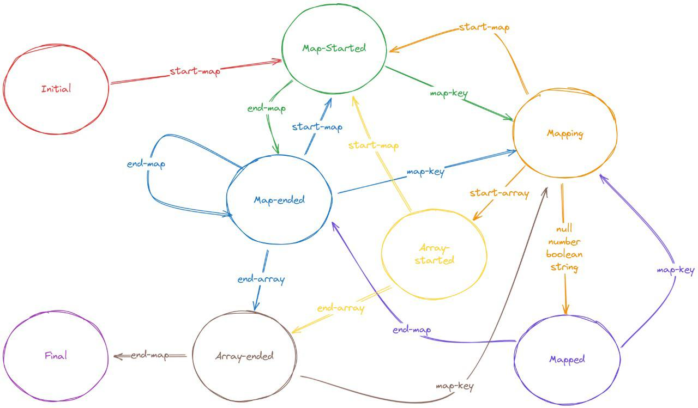

# Nodenamer (legacy Python version)

This is the first version of the Lightning Nodenamer, written for the
Chaincode Hackathon ([proposal](Hackathon-Project-NodeNamer.pdf)). It is
kept for reference while the project is rewritten in Go (see the
[main README](../README.md)) and is no longer maintained. Its fingerprint
templates (`src/feature_bits_templates.py`) were collected from 2023/2024
releases and are out of date; the current values are in
[`docs/fingerprints.md`](../docs/fingerprints.md).

Input: a JSON dump of the public graph, produced on an LND node with
`lncli describegraph`. Sample dumps are in [`graphs/`](graphs/).

Output (`nodenamer.log`): one line per node with
- Node ID: the hex-encoded pubkey of the node.
- Implementation: LND, CLN, ECLR, LDK or UNKNOWN.
- Version: the implementation version or UNKNOWN.

## Dependencies

The script uses [ijson](https://pypi.org/project/ijson/) to stream large
JSON files without loading them into memory.

```sh
pip install ijson
```

## How to run

```sh
cd legacy/src
python nodenamer.py <graph json_file> <log_dir>
```

It creates:
- `nodenamer.log`, `nodenamer-features.log` and `nodenamer-features-total.log`
  in `<log_dir>`.
- `nodenamer-unknown-fingerprints.txt` next to the graph file. It lists the
  feature-bit sets that matched no template, to help find new fingerprints.

On screen it prints the number of nodes and channels, the node count and
capacity per implementation (including unknown nodes, nodes without updates
and nodes without feature bits), and how many nodes use each feature bit.

## Approach

The script identifies a node's implementation in three layers, from the
strongest signal to the weakest:

1. Feature bits, matched against the templates. A node identified here
   skips the other layers.
2. Default channel policy (`time_lock_delta`) of the node's channels.
3. Default node color.

Known bugs, not fixed: in the second layer the implementation with the most
votes is not tracked correctly (`max_value` is never updated), and the
feature-bit name lookup can return the wrong name.

The JSON file is read with a state machine:



## Grafana integration

The script's logs were shipped with Promtail to Grafana Cloud (Loki) and
shown on a
[public dashboard](https://pins.grafana.net/public-dashboards/478199ff803c44138feb1439908e891f),
exported in
[`lightning-nodenamer-grafana-dashboard.json`](../lightning-nodenamer-grafana-dashboard.json).

- `nodenamer.log`: pubkey, implementation and version per node.
- `nodenamer-features.log`: one line per feature bit of each node. Not
  used: Grafana Cloud complained about the ingestion rate.
- `nodenamer-features-total.log`: one line per feature bit with the number
  of nodes using it.

To run Promtail with Docker:

```sh
docker pull grafana/promtail:latest
```

and follow the
[Grafana Cloud instructions](https://grafana.com/docs/grafana-cloud/send-data/logs/collect-logs-with-promtail/#option-1-send-logs-from-a-standalone-host)
for a standalone host.
